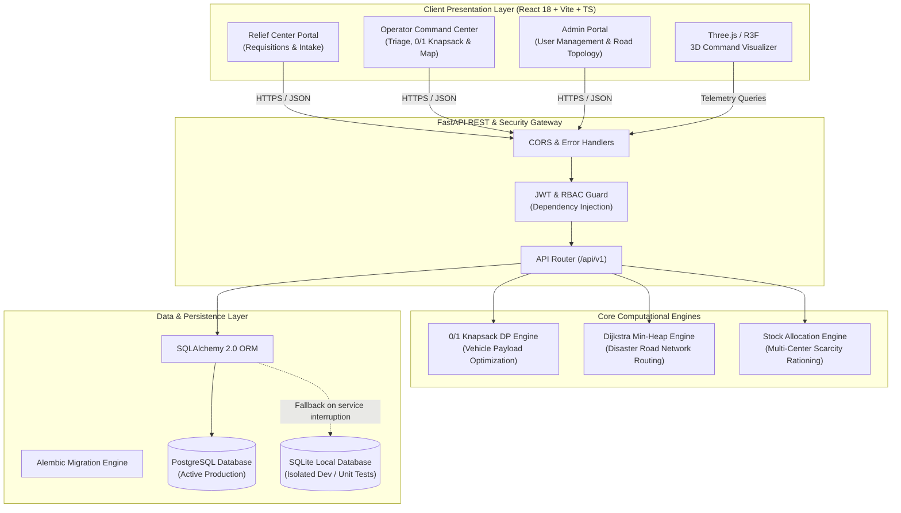

# RESQ-X: System Architecture Document

## 1. Architectural Principles & High-Level Design

RESQ-X is engineered as a decoupled, multi-tier disaster relief coordination platform designed for high throughput, algorithmic correctness, and fail-safe operation during regional emergencies.

---

## 2. Component Separation & Algorithmic Responsibilities

### Strict Algorithmic Distinction
A fundamental architectural tenet of RESQ-X is the explicit segregation of computational concerns:

1. **0/1 Knapsack Dynamic Programming**:
   - **Scope**: Single-vehicle payload capacity optimization.
   - **Input**: Vehicle capacity $W$ (kg), set of candidate relief items with weights $w_i$ and life-saving priority scores $v_i$.
   - **Output**: Optimal subset of items maximizing total priority without exceeding payload capacity.
   - **State Space**: $DP[i][w] = \max(DP[i-1][w], DP[i-1][w - w_i] + v_i)$.

2. **Dijkstra's Shortest Path Algorithm**:
   - **Scope**: Optimal terrestrial route computation across disaster-affected transportation networks.
   - **Data Structure**: Min-Heap Priority Queue (`heapq`).
   - **Cost Metric**: $\text{Effective Weight} = \text{Distance (km)} \times \text{Condition Multiplier} \times \text{Risk Factor}$.
   - **Hazard Filtering**: Completely bypasses severed bridges, flooded roads, and landslides (`is_blocked == True`).

3. **Multi-Center Inventory Triage Engine**:
   - **Scope**: Rationing limited central warehouse stocks among competing relief centers under resource scarcity.
   - **Heuristic**: Weighted multi-factor allocation scoring severity level, affected human population, and urgency rating.

---

## 3. Security Architecture

1. **Token-Based Authentication**: Stateless expiring JSON Web Tokens (JWT) signed with HMAC-SHA256.
2. **Password Storage**: Salting and hashing via `passlib` with `bcrypt`.
3. **Role-Based Access Control (RBAC)**: Backend endpoint enforcement; roles are never trusted from client-side payloads.
4. **Tenant Isolation**: Relief Centers cannot read or mutate requisitions belonging to peer camps.
5. **No Public Operator Self-Registration**: Operator accounts can only be provisioned by authenticated Administrators.
